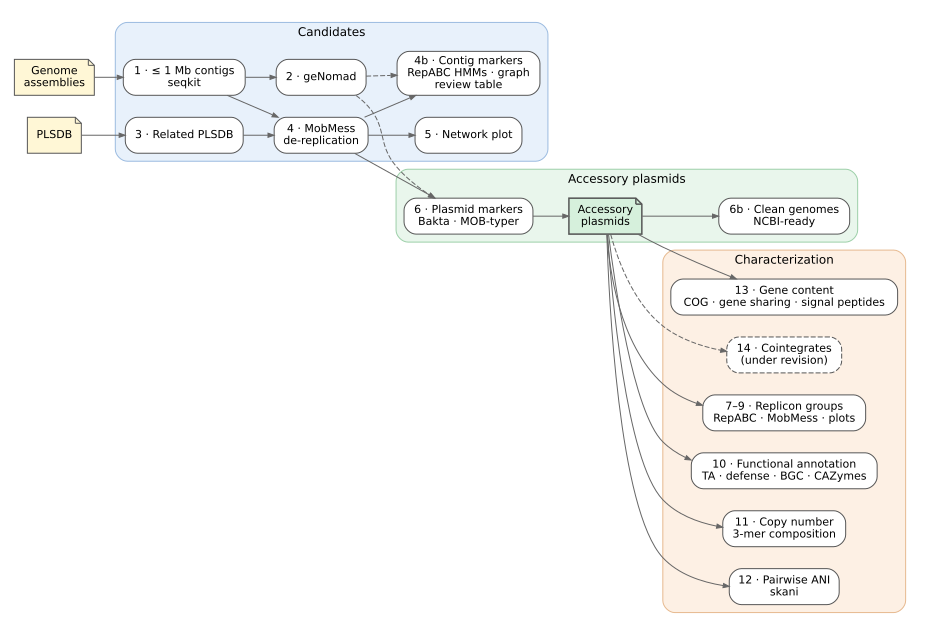

# Accessory Plasmids Identifier

This represent the commands used during my work: **"Sinorhizobium meliloti Accessory Plasmidome: Characterization of Diversity, Gene Content, and Organization of Novel Large Plasmids"**

With the help of Claude, tools used were organized into a Nextflow pipeline to detect accessory plasmids in *Sinorhizobium meliloti* genome assemblies.

This is result of our work done annotating and describing novel *Sinorhizobium meliloti* accessory plasmids.



A more detailed diagram is in [assets/workflow.svg](assets/workflow.svg).
Both are generated from Graphviz.

## Contents

- [0. Genome assembly (upstream, not part of this pipeline)](#0-genome-assembly-upstream-not-part-of-this-pipeline)
- [Input](#input)
- [Usage](#usage)
- [Steps](#steps)
  - [1. Contig length filter (`seqkit seq`)](#1-contig-length-filter-seqkit-seq)
  - [2. Plasmid classification (`geNomad end-to-end`)](#2-plasmid-classification-genomad-end-to-end)
  - [3. Related PLSDB plasmids (`select_plsdb.py`, optional `mash dist`, `seqkit grep`)](#3-related-plsdb-plasmids-select_plsdbpy-optional-mash-dist-seqkit-grep)
  - [4. De-replication with MobMess (`mobmess systems`)](#4-de-replication-with-mobmess-mobmess-systems)
  - [5. MobMess containment network (`networkx`, `ipysigma`)](#5-mobmess-containment-network-networkx-ipysigma)
  - [6. Plasmid markers (`bakta`, `mob_typer`, geNomad)](#6-plasmid-markers-bakta-mob_typer-genomad)
  - [7. RepABC operons and replicon groups (`repabc_operons.py`, `mmseqs easy-cluster`)](#7-repabc-operons-and-replicon-groups-repabc_operonspy-mmseqs-easy-cluster)
  - [8. MobMess on the final accessory plasmids](#8-mobmess-on-the-final-accessory-plasmids)
  - [9. Summary table and figures (`matplotlib`, `seaborn`)](#9-summary-table-and-figures-matplotlib-seaborn)
  - [10. Functional annotation (`bakta`, TASmania, `defense-finder`, `antismash`, `run_dbcan`, SignalP)](#10-functional-annotation-bakta-tasmania-defense-finder-antismash-run_dbcan-signalp)
  - [11. Replicon tags, copy number and 3-mer composition (`minimap2`, `samtools`, `kmertools`)](#11-replicon-tags-copy-number-and-3-mer-composition-minimap2-samtools-kmertools)
  - [12. Pairwise ANI between accessory plasmids (`skani dist`)](#12-pairwise-ani-between-accessory-plasmids-skani-dist)
  - [13. Gene content (`eggnog-mapper`, `panaroo`)](#13-gene-content-eggnog-mapper-panaroo)
- [Parameters](#parameters)
- [Software](#software)

## 0. Genome assembly (upstream, not part of this pipeline)

The pipeline starts from genome assemblies. We recommend assembling with
[nf-core/bacass 2.6.0](https://nf-co.re/bacass/2.6.0), for example:

```bash
nextflow run nf-core/bacass -r 2.6.0 -profile singularity \
    --input bacass_samplesheet.csv --assembly_type hybrid --outdir results_bacass
```

The pipeline currently requires **Flye** assemblies: contig circularity is read from
Flye's `assembly_info.txt`. Use the **final (polished)** assembly as `assembly`: in the publication,
Nanopore assemblies were polished with Medaka (`<sample>/medaka_polish/<sample>_asm.fasta`), while PacBio HiFi
assemblies were used as produced by Flye (`<sample>/<sample>_asm.fasta`). `assembly_info` is Flye's
`assembly_info.txt` of the same assembly (contig names and circularity are unchanged by polishing).

## Input

A CSV samplesheet with one Flye assembly per sample (see `assets/samplesheet_example.csv`):

| column          | description                                              |
|-----------------|----------------------------------------------------------|
| `sample`        | unique sample name, without whitespace                   |
| `assembly`      | path to the assembly FASTA (`.fasta`, `.fa`, `.fna`, `.gz` accepted) |
| `assembly_info` | path to Flye's `assembly_info.txt` for that assembly     |
| `bam`           | optional reads mapped back to this assembly (sorted BAM), used for plasmid copy number |
| `gff`           | optional whole-genome Bakta GFF3 of this assembly, used for gene sharing (Step 13) |
| `dataset`       | optional group used to colour the figures (e.g. `Penn State`, `In-house`); default `Sample`. `Database` is reserved for PLSDB plasmids |

## Usage

```bash
nextflow run accessory_plasmids -profile conda \
    --input samplesheet.csv --genomad_db /path/to/genomad_db \
    --plsdb_fasta plsdb.fasta --plsdb_nuccore nuccore.csv --plsdb_typing typing.csv \
    --bakta_db /path/to/bakta_db/db --mobsuite_db /path/to/mob_suite/databases \
    --tasmania_hmms /path/to/TASmania_HMMs --defensefinder_models ~/.macsyfinder/models \
    --antismash_db /path/to/antismash/databases --dbcan_db /path/to/dbcan_db \
    --outdir results
```

Software is provided only through conda: always use the `conda` profile. Each step builds its own
environment from `modules/local/<step>/environment.yml` the first time it runs.
Add `slurm` to submit jobs to SLURM: `-profile conda,slurm`.

## Steps

### 1. Contig length filter (`seqkit seq`)

Keeps contigs **up to `--max_contig_len` bp each** (default `1000000`). This removes the chromosome, pSymA and pSymB, leaving candidate accessory replicons.

By default, each contig ID gets the sample name appended (`contig_4` → `contig_4_TG107`),
so IDs stay unique when contigs from many genomes are pooled. IDs that already end in `_<sample>` (e.g. renamed
or polished assemblies) are left unchanged, and only the first word of each header is kept. Turn the suffix off
with `--add_sample_suffix false`.

Samples with no contig under the threshold are reported with a warning and skipped in later steps.

Output: `results/01_contig_length_filter/`
- `<sample>.max_len_filtered.fasta`: retained contigs
- `<sample>.contig_lengths.tsv`: retained contig IDs and lengths

### 2. Plasmid classification (`geNomad end-to-end`)

Classifies each retained contig as plasmid, virus or chromosome with
[geNomad](https://github.com/apcamargo/genomad) 1.12.0, using default thresholds
(no `--relaxed`/`--conservative`). Score calibration is off (geNomad default), so
per-sample results are identical to running all contigs pooled.

The geNomad database is required (`--genomad_db`). The publication used **database v1.9**.
Download it once, outside the pipeline:

```bash
genomad download-database /path/to/
```

`download-database` always fetches the latest release. For reproducibility, check
`genomad_db/version.txt`; it is also recorded in `versions.yml`.

At this step the geNomad results are reported only; no contig is removed.

Output: `results/02_genomad/<sample>/`
- `<sample>_summary/<sample>_plasmid_summary.tsv`: contigs classified as plasmid (score, topology, hallmarks, conjugation and AMR genes)
- `<sample>_summary/<sample>_plasmid.fna`, `_plasmid_genes.tsv`, `_plasmid_proteins.faa`: plasmid sequences, genes and proteins
- `<sample>_summary/<sample>_virus_summary.tsv`, `_virus.fna`: contigs classified as virus
- `<sample>_aggregated_classification/<sample>_aggregated_classification.tsv`: chromosome/plasmid/virus scores for every contig
- `*.log`: geNomad logs

### 3. Related PLSDB plasmids (`select_plsdb.py`, optional `mash dist`, `seqkit grep`)

Collects public plasmids related to *S. meliloti* from [PLSDB](https://doi.org/10.1093/nar/gkae1095)
(publication: version 2024_05_31_v2). They are pooled with the sample contigs for de-replication in the next step.

A PLSDB record is selected if:
1. **Metadata (always):** `--plsdb_keyword` (default `meliloti`, case-insensitive) appears in the
   MOB-typer nearest-neighbour species (`mash_neighbor_identification`) or in the record description
   (`NUCCORE_Description`). With PLSDB 2024_05_31_v2 this gives the 224 records used in the publication.
2. **Mash (optional, `--plsdb_mash`):** a PLSDB plasmid is within `--mash_max_dist` and `--mash_max_pvalue`
   of any filtered contig (`mash dist -i` against the PLSDB sketch).

No length filter is applied to PLSDB records: megaplasmid-sized records (e.g. pSymA/pSymB) must stay in so
that clusters containing them can be discarded during de-replication.

All PLSDB inputs are files distributed with PLSDB: the sequences FASTA, `nuccore.csv` (record metadata)
and `typing.csv` (MOB-typer results). The two tables are joined on `NUCCORE_ACC`; their rows are not in the
same order. The run stops if an accession is duplicated or missing from `typing.csv`.

Output: `results/03_plsdb_related/`
- `plsdb_related.fasta`: selected PLSDB plasmids, headers trimmed to the accession
- `plsdb_related.circular.tsv`: `accession<tab>1/0` (circular/linear), used by MobMess
- `plsdb_related.sources.tsv`: why each record was selected (`metadata`, `mash` or both)
- `plsdb_related.ids.txt`: selected accessions
- `<sample>.mash_dist_plsdb.tsv`: Mash hits (only with `--plsdb_mash`)

### 4. De-replication with MobMess (`mobmess systems`)

Sample contigs (Step 1) and related PLSDB plasmids (Step 3) are pooled, sorted by ID and clustered with
[MobMess](https://doi.org/10.1038/s41564-024-01610-3) (default 90% identity and 90% coverage).
Circularity comes from Flye's `assembly_info.txt` (`circ.` column) for sample contigs and from
`NUCCORE_Topology` for PLSDB plasmids. The run stops on duplicated IDs or if any sequence lacks circularity.

Clusters are then kept only if they look like real plasmids:

| MobMess cluster type    | kept when                                                              |
|-------------------------|------------------------------------------------------------------------|
| `fragment`              | never                                                                  |
| `backbone`              | all members < `--mobmess_max_len`                                      |
| `compound`              | all members < `--mobmess_max_len` and at least one circular member     |
| `maximal_not_in_system` | as `compound`, plus at least one member is a sample contig (not PLSDB) |

Clusters made only of PLSDB plasmids are kept when they are `backbone` or `compound`: MobMess places
them in plasmid systems, so their relationship to *S. meliloti* plasmids is established. A PLSDB-only
`maximal_not_in_system` cluster is related only through the PLSDB annotation used to select it,
so it is discarded.

Output: `results/04_mobmess/`
- `<sample>.circular.tsv`: circularity of each sample's filtered contigs
- `<sample>.coverage.tsv`: Flye read depth of each filtered contig, and relative to the chromosome
- `mobmess_input.fasta`, `mobmess_input.circular.tsv`: pooled MobMess input
- `mobmess_clusters.txt`, `mobmess_systems.txt`, `mobmess_contigs.txt`, `mobmess_ani*.txt`, `*_graph.*`: MobMess output
- `mobmess.filtered_clusters.tsv`: clusters that passed, with `length` and `source` (`sample`/`plsdb`)
- `mobmess.filtered.fasta`, `mobmess.filtered_ids.txt`: sequences that passed

### 5. MobMess containment network (`networkx`, `ipysigma`)

Interactive plot of the MobMess containment network with **all** clusters, before filtering
(publication Fig. S2A). Nodes are sequences, edges are containment relationships. Nodes are coloured
by MobMess cluster type (backbone, compound, maximal, fragment) and sized by length. Hovering over a
node shows its attributes:

| attribute       | description                                                       |
|-----------------|-------------------------------------------------------------------|
| `length`, `gc`  | sequence length (bp) and GC % (G+C over length)                    |
| `source`        | `sample` or `plsdb`                                               |
| `genomad`       | `plasmid` / `not_plasmid` (Step 2); `not_tested` for PLSDB plasmids |
| `passed_filter` | `1` if the sequence passed the MobMess cluster filter (Step 4)    |

The layout (ForceAtlas2) is computed in the browser when the HTML file is opened, so it can differ slightly
between openings.

Output: `results/05_network/`
- `mobmess_network.html`: interactive network (open in a web browser)
- `mobmess_network.graphml`: annotated graph, e.g. for Gephi or Cytoscape
- `mobmess_network.nodes.tsv`: node attribute table

### 6. Plasmid markers (`bakta`, `mob_typer`, geNomad)

Sequences that passed the MobMess filter (Step 4) are annotated in one [Bakta](https://doi.org/10.1099/mgen.0.000685)
run (`--keep-contig-headers`) and typed with [MOB-typer](https://doi.org/10.1099/mgen.0.000206) (`--multi`).
A sequence is kept as an accessory plasmid when:

1. Bakta annotates a **replication or partition protein**: product matching, case-insensitive,
   `(?:^(?:(?:plasmid[\s/_-]*)?replication)|partition|para\s|parb\s)` (e.g. RepA/B/C, ParA, ParB); or
2. geNomad (Step 2) reports a **MOB relaxase** among its conjugation genes. This rescues plasmids without an
   annotated replication protein, such as a MOBV plasmid made mostly of hypothetical proteins.
   PLSDB plasmids are not run through geNomad, so only rule 1 applies to them.

Sequences listed in `--feature_exclude` (one ID per line, `#` comments allowed) are removed after manual
curation. `assets/feature_exclude_publication.txt` holds the exclusion used in the publication.
MOB-typer results are reported but are not used to decide.

**Review flag.** Small plasmids are usually high-copy. A kept sample plasmid shorter than `--flag_max_len`
(default 50 kb) whose Flye read depth is below `--flag_min_rel_cov` (default 0.5) times the depth of its
chromosome (largest contig of the assembly) gets `review_flag = low_coverage_small`. The flag does not
remove anything: low depth can mean contamination, plasmid loss or a mixed culture, so check flagged
plasmids and add them to `--feature_exclude` if needed. In the publication data, contig_8_TG153 (14.3 kb,
0.28x) was excluded this way, and contig_5_TG24 (44 kb, ParB, 0.35x) is flagged but was kept.

Output: `results/06_plasmid_features/`
- `plasmid_features.features.tsv`: one row per sequence with its markers, Flye `depth` and `rel_coverage`,
  `keep` (1/0), `reason` (`rep_partition`, `genomad_mob`, `excluded`, `no_marker`) and `review_flag`
- `plasmid_features.rep_proteins.tsv`: Bakta features matching the replication/partition pattern
- `plasmid_features.fasta`, `plasmid_features.ids.txt`: accessory plasmids kept
- `bakta/`: Bakta annotation (`.tsv`, `.gff3`, `.gbff`, `.faa`, ...)
- `mob_typer/`: MOB-typer reports
- `plasmid_features.circular.tsv`: circularity of the kept plasmids (input of Step 8)

### 7. RepABC operons and replicon groups (`repabc_operons.py`, `mmseqs easy-cluster`)

**RepABC operons.** Among the Bakta replication/partition features of the kept plasmids, those whose product
matches `[rR]ep[ABC]` are scanned from each *repA*: 4 kb downstream (+ strand) or upstream (− strand). A window
holding *repA*, *repB* and *repC* is a complete operon. With the publication data this gives 403 plasmids with
*repA* and 394 with a complete operon. `--repabc_wrap_circular true` also lets windows wrap around the origin
of circular plasmids (398 complete operons; the representative RepA set does not change).

**Representative RepA.** A plasmid is typed only when it has exactly one *repA*: the one of its complete operon,
or its single *repA* (401 plasmids in the publication).

**Replicon groups.** Following [Cavassim *et al.* (2020)](https://doi.org/10.1099/mgen.0.000351), representative
RepA proteins are clustered together with the eight *Rhizobium leguminosarum* reference RepA
(`assets/Rh_repA_replicons.fasta`, groups Rh01–Rh08) using MMseqs2 (`--min-seq-id 0.9 -c 0.7`).
A cluster with a reference takes its name; other clusters are named Si01, Si02, ... by decreasing size.
Equal-sized clusters have no natural order, so `--replicon_names` (sequence `<tab>` group) keeps earlier
names: a cluster takes the listed name held by most of its members, and new clusters get the next Si number.
`assets/replicon_group_names_publication.tsv` reproduces the publication's groups exactly.

Output: `results/07_replicon_groups/`
- `repabc.summary.tsv`: per plasmid, rep genes found, complete operon (1/0) and representative RepA locus
- `repabc.operons.tsv`: the rep features behind each call
- `repA.replicon_groups.tsv`: plasmid, RepA locus, replicon group, cluster representative and group size
- `repA.faa`, `repA_clust_cluster.tsv`, `repA_clust_rep_seq.fasta`: RepA proteins and MMseqs2 clusters

### 8. MobMess on the final accessory plasmids

MobMess is run again (as in Step 4) on the plasmids kept in Step 6 only, so clusters and plasmid systems
reflect the final set. Cluster IDs differ from Step 4.

Output: `results/08_mobmess_final/`: `mobmess_final_clusters.txt`, `mobmess_final_systems.txt`, graphs, etc.

### 9. Summary table and figures (`matplotlib`, `seaborn`)

One table and four figures (PNG and SVG) of the accessory plasmids. Plasmids are coloured by the samplesheet
`dataset` column; PLSDB plasmids are `Database` (grey).

| file | content |
|------|---------|
| `plasmid_summary.tsv` | one row per accessory plasmid: sample, dataset, length, MobMess cluster, replicon group, RepABC, MOB-typer, geNomad, coverage and review flag |
| `features_stackbar` | % of plasmids per relaxase type, MPF type, predicted mobility, host range (top 8) and rep genes |
| `rep_proteins_heatmap` | replication/partition proteins per plasmid; rows clustered (Hamming distance, average linkage) and coloured by dataset |
| `replicon_groups_by_dataset` | plasmids per replicon group, stacked by dataset |
| `replicon_multiplicity_length` | length of plasmids with single vs duplicated RepA/B/C, with a Mann-Whitney U test |
| `replicon_cooccurrence_upset` | UpSet plot of replicon groups carried together by the same strain (sample plasmids with a replicon group) |
| `plasmids_per_strain` | strains by number of accessory plasmids (strains with at least one; all accessory plasmids) |

Percentages in `features_stackbar` are per plasmid (all accessory plasmids), whereas the publication notebook
counted one row per rep gene of plasmids carrying RepA.

Output: `results/09_summary/`

### 10. Functional annotation (`bakta`, TASmania, `defense-finder`, `antismash`, `run_dbcan`, SignalP)

Each accessory plasmid (Step 6) is annotated **on its own** with Bakta, as in the publication, so a plasmid's
genes do not depend on which other plasmids are in the run. The per-plasmid annotations are merged
(proteins renamed `<locus>__<plasmid>`) and searched for:

| feature | tool | settings |
|---------|------|----------|
| Toxin-antitoxin genes | [TASmania](https://doi.org/10.1371/journal.pcbi.1006946) HMMs with pyhmmer `hmmsearch`, scored like TASer | see below |
| Defense / anti-defense systems | [DefenseFinder](https://doi.org/10.1038/s41467-022-30269-9) 3.0.0 | per plasmid; `--db-type ordered_replicon --coverage 0.4 --antidefensefinder` |
| Biosynthetic gene clusters | [antiSMASH](https://doi.org/10.1093/nar/gkaf334) 8.0.4 | all plasmids in one run; `--cb-general --cc-mibig --taxon bacteria`; genes from Bakta |
| CAZymes | [run_dbcan](https://doi.org/10.1093/nar/gkad328) 5.2.9 | `--methods` `--dbcan_methods`; kept if found by ≥ `--cazyme_min_tools` (2) tools |
| Signal peptides of CAZymes (optional) | SignalP 6.0 (fast, organism other) | only with `--signalp_module` and `--signalp_model_dir` |

**Toxin-antitoxin (TASer-like).** The publication used the [TASer web server](https://shiny.bioinformatics.unibe.ch/apps/tasmania/),
which also reports whether each gene is a toxin or antitoxin and its pseudo-operon structure (e.g. `TA`, `xTA`,
`Ax`). TASer can only be run on its web page, so the pipeline reproduces its method locally. The rules were
inferred from the publication's TASer reports:
- genes are predicted with Prodigal (pyrodigal, single mode) **trained on all plasmids of the run**, as TASer
  does on a submission (this reproduces 100% of TASer's gene coordinates for the same submission). TASer
  calls its own genes, and Bakta misses some small TA genes;
- each protein is scored alone against the TASmania HMMs (E-values with Z = 1), so E-values do not depend on how
  many plasmids are analysed;
- each gene keeps its best HMM and is reported at E < `--ta_report_evalue` (0.01);
- T (toxin) / A (antitoxin) comes from the TASmania HMM (`T.<id>` / `A.<id>`);
- pseudo-operons are genes on the same strand with intergenic distance −100 to +100 nt; the structure lists them
  in genomic order as T, A or x (no TA hit).

Each TA gene is linked to the Bakta gene it overlaps (≥ 50% of both lengths) for its name and product. Counts
(as in the publication notebook) use genes with E < `--ta_evalue` (1e-3) that are not RepA/B/C proteins.

Agreement with the publication's TASer reports:

| run | TASer genes found | same T/A and HMM | same operon structure |
|-----|-------------------|------------------|-----------------------|
| same submissions as TASer (6 batches of ~70 plasmids) | 3,493 / 3,494 | 100% | 94–99.6% |
| all plasmids in one run (as the pipeline does) | 3,347 / 3,494 (95.8%) | 100% | 95.1% |

Gene training depends on which plasmids are in the run, so a few gene calls change with the plasmid set. With
less than 100 kb of plasmid sequence in total, Prodigal cannot be trained and metagenome mode is used instead.
E-values are about 5% lower than TASer's (HMMER 3.4 vs 3.1). TASer also adds a `?` at the edge of some operons,
mostly next to a contig end; its meaning is not documented and it is not reproduced.

**dbCAN tools.** In the publication the CAZy DIAMOND search returned no output, so in practice both dbCAN-HMM
and dbCAN-sub had to agree. The pipeline runs all three tools and stops if DIAMOND produces nothing. With the
publication data, DIAMOND adds 10 CAZymes (759 instead of 749) and no new plasmid (339). Use
`--dbcan_methods hmm,dbCANsub` to reproduce the published set exactly.

**SignalP** is licensed and cannot be installed by conda. On a cluster with an environment module, run with e.g.
`--signalp_module signalp/6.0-fast --signalp_model_dir /path/to/signalp-6-package/models/`.

The whole step is skipped with `--skip_annotation`.

Output: `results/10_annotation/`
- `annotation_summary.tsv`: per plasmid, number of TA genes, complete TA pseudo-operons (toxin + antitoxin) and their
  structures, defense systems (and types), BGC regions (and types), CAZymes (and families)
- `tasmania.genes.faa` (Prodigal proteins), `tasmania.hits.csv` (all HMM hits), `tasmania.ta.tsv` (TA genes: T/A,
  best HMM, E-value, operon ID and structure, overlapping Bakta gene/product, `count` = used in counts)
- `defense_systems.tsv` (all plasmids), `defensefinder/<plasmid>_defense_finder_{systems,genes,hmmer}.tsv`
- `bgc_regions.tsv` (region and product per plasmid), `antismash/` (full antiSMASH output)
- `cazymes.tsv`, `cazymes_signalp.tsv`, `dbcan/` (run_dbcan output), `signalp/` (if run)
- `plasmids.tsv`, `plasmids_proteins.faa`, `plasmids.gbff` (merged annotation), `bakta/<plasmid>/` (per plasmid)
- Figures: `ta_heatmap_per_plasmid`, `ta_heatmap_per_cluster`, `ta_operon_structures`, `defense_heatmap_per_cluster`,
  `bgc_types`, `cazyme_families`

### 11. Replicon tags, copy number and 3-mer composition (`minimap2`, `samtools`, `kmertools`)

Runs when `--reference_genome` is given (publication: *S. meliloti* GCF_037023865.1).

**Replicon tags.** Each assembly is aligned to the reference (`minimap2 -x asm5 --end-bonus 100 --secondary=no`).
Each contig keeps its longest alignment block, and each reference replicon (`--reference_tags`: chromosome, pSymA,
pSymB) is given to the single contig with the longest block; other contigs are `Other`. This is the publication
rule and reproduces its tags for all 346 strains. As a safeguard, a tag is kept only if the contig covers at least
`--tag_min_ref_cov` % (30) of the replicon. Without it, when a replicon is fused to another (e.g. chromosome +
pSymB), the tag slides to an unrelated contig: in the publication, two plasmids were tagged pSymB while covering
< 1% of pSymB (all other tags cover ≥ 41%). `--tag_min_ref_cov 0` reproduces the publication exactly.

**Copy number** (samples with a `bam` in the samplesheet). Copy number = median per-base read depth of the plasmid /
median depth of the chromosome (`samtools depth -a`; 1 kb ignored at each contig end). pSymA and pSymB are reported
as a sanity check (expected ≈ 1). Reproduces the publication's values exactly.

**3-mer composition.** Accessory plasmids (Step 6, PLSDB excluded) and all main replicons are compared by
[Kmertools](https://github.com/anuradhawick/kmertools) 3-mer frequencies (32 canonical 3-mers), Bray-Curtis
distances and a UMAP (random_state 42). Length and GC of accessory plasmids are compared with each main replicon
type (two-sided Mann-Whitney U, Bonferroni).

Output: `results/11_replicons/`
- `tags/<sample>.replicon_tags.tsv`: tag, length, best reference replicon and its coverage, per contig
- `copy_number.tsv` (all samples), `copy_number/<sample>.copy_number.tsv`
- `kmer/kmer_3mer_frequencies.tsv`, `kmer/kmer_umap.tsv`, `kmer/kmer_stats.tsv`; figures `kmer_umap`, `replicon_length`, `replicon_gc`

### 12. Pairwise ANI between accessory plasmids (`skani dist`)

All accessory plasmids (Step 6) are compared all-vs-all with [skani](https://doi.org/10.1038/s41592-023-02018-3)
(default settings). Each plasmid is written to its own FASTA first: this reproduces the publication's values exactly,
whereas `--qi/--ri` on one multi-FASTA changes ~4% of them. The alignment fraction of each pair is that of the
longer plasmid, `AF = min(Align_fraction_ref, Align_fraction_query)` (publication Fig. S2D).

Output: `results/12_plasmid_ani/`
- `skani_dist.tsv`: skani output; `plasmid_ani.tsv`: pairs (self-comparisons removed) with `AF`
- `ani_vs_af`: hexbin density of AF vs ANI

### 13. Gene content (`eggnog-mapper`, `panaroo`)

Needs the Step 10 annotation. Two parts, each optional:

**A. COG analysis of accessory plasmids** (with `--eggnog_db`). The accessory plasmid proteins are annotated with
[eggNOG-mapper](https://doi.org/10.1093/molbev/msab293) 2.1.13 (`-m mmseqs`, eggNOG database 5.0.2 in the publication).
Then, as in the publication notebook:
- COG category counts (each letter of a multi-letter category counted once);
- gene content: presence/absence of the root eggNOG orthologous group per plasmid, Jaccard distances, PCoA and
  metric MDS, coloured by the 10 largest MobMess clusters (clusters with ≥ 5 plasmids);
- COG enrichment per MobMess cluster with more than `--cog_min_cluster` (3) plasmids: one-sided Fisher exact test
  (cluster vs all other plasmids) on the number of plasmids carrying each COG letter, Benjamini-Hochberg over all
  tests; significant at FDR < 0.05 and log2FC > 0.2;
- COG composition per cluster (clusters with ≥ `--cog_min_cluster` plasmids; note: ≥ here, > for the enrichment, as in
  the publication), row z-scores.

On the publication's eggNOG output this reproduces the notebook's enrichment exactly (440 tests, 21 significant).

**B. Gene sharing with the main replicons** (with `--gene_sharing`, `--reference_genome` and a `gff` column in the
samplesheet: the whole-genome Bakta GFF3 of each assembly). [Panaroo](https://doi.org/10.1186/s13059-020-02090-4) 1.6.0
(`--clean-mode moderate --remove-invalid-genes`) is run on the whole genomes plus one standalone GFF per accessory plasmid
(Step 10). Gene families are assigned to accessory plasmids only through the standalone plasmid GFFs, and to the
chromosome / pSymA / pSymB through the genome GFFs and the Step 11 tags (genes on accessory-plasmid contigs skipped,
so nothing is counted twice). On the publication's Panaroo output this reproduces `family_group_membership.csv`
exactly and 34.6% of accessory-plasmid families shared with a main replicon. Panaroo on hundreds of genomes needs
a large node (`process_panaroo`: 32 CPUs, 100 GB, 72 h; the publication used 70 CPUs).

Output: `results/13_gene_content/`
- `eggnog_mapper/plasmids_eggnog.emapper.*`
- `cog_analysis/`: `cog_counts.tsv`, `og_presence_absence.tsv`, `cog_ordination.tsv`, `cog_enrichment.tsv` (all tests),
  `cog_enrichment_significant.tsv`; figures `cog_counts`, `cog_pcoa`, `cog_mds`, `cog_enrichment_dotplot`, `cog_cluster_heatmap`
- `panaroo/`: Panaroo output
- `gene_sharing/`: `family_group_membership.csv`, `gene_sharing_summary.tsv`, `shared_families_cog.tsv`;
  figures `gene_sharing_upset`, `shared_families_cog`

## Parameters

| parameter             | default   | description                                    |
|-----------------------|-----------|------------------------------------------------|
| `--input`             | required  | samplesheet CSV                                |
| `--outdir`            | `results` | output directory                               |
| `--max_contig_len`    | `1000000` | maximum contig length (bp) to keep             |
| `--add_sample_suffix` | `true`    | append `_<sample>` to contig IDs               |
| `--genomad_db`        | required  | geNomad database directory                     |
| `--plsdb_fasta`       | required  | PLSDB sequences FASTA                          |
| `--plsdb_nuccore`     | required  | PLSDB `nuccore.csv`                            |
| `--plsdb_typing`      | required  | PLSDB `typing.csv` (MOB-typer)                 |
| `--plsdb_keyword`     | `meliloti`| keyword for metadata-based selection           |
| `--plsdb_mash`        | `false`   | also add PLSDB Mash hits to the filtered contigs |
| `--plsdb_sketch`      | -         | PLSDB Mash sketch (required with `--plsdb_mash`) |
| `--mash_max_dist`     | `0.1`     | `mash dist -d`                                 |
| `--mash_max_pvalue`   | `0.1`     | `mash dist -v`                                 |
| `--mobmess_max_len`   | `1000000` | MobMess clusters are kept only if all members are shorter (bp) |
| `--bakta_db`          | required  | Bakta database directory (`bakta_db download --type full`) |
| `--mobsuite_db`       | required  | MOB-suite database directory (`mob_init -d <dir>`) |
| `--feature_exclude`   | -         | IDs to exclude after manual curation          |
| `--flag_max_len`      | `50000`   | review flag: plasmids shorter than this (bp)  |
| `--flag_min_rel_cov`  | `0.5`     | review flag: depth below this × chromosome depth |
| `--repabc_wrap_circular` | `false` | RepABC windows wrap around circular plasmids |
| `--repa_references`   | `assets/Rh_repA_replicons.fasta` | reference RepA proteins (headers with `Rh<n>`) |
| `--replicon_names`    | -         | sequence `<tab>` replicon group, to keep earlier names |
| `--skip_annotation`   | `false`   | skip Step 10                                  |
| `--tasmania_hmms`     | required* | directory of TASmania `*.hmm3` HMMs           |
| `--ta_evalue`         | `1e-3`    | TA genes counted below this E-value (per protein, Z = 1) |
| `--ta_report_evalue`  | `1e-2`    | TA genes reported and used for operon structures |
| `--defensefinder_models` | required* | macsyfinder models directory with `defense-finder-models` |
| `--antismash_db`      | required* | antiSMASH databases (`download-antismash-databases`) |
| `--dbcan_db`          | required* | dbCAN database (`run_dbcan database`)         |
| `--dbcan_methods`     | `diamond,hmm,dbCANsub` | dbCAN tools to run                |
| `--cazyme_min_tools`  | `2`       | minimum dbCAN tools supporting a CAZyme       |
| `--signalp_module`    | -         | environment module providing `signalp6` (optional) |
| `--signalp_model_dir` | -         | SignalP 6 model directory                     |
| `--reference_genome`  | -         | reference genome FASTA; enables Step 11       |
| `--reference_tags`    | `assets/reference_replicon_tags.tsv` | reference replicon `<tab>` tag (Chromosome/pSymA/pSymB) |
| `--tag_min_ref_cov`   | `30`      | minimum % coverage of the replicon for a tag (0 = publication rule) |
| `--eggnog_db`         | -         | eggNOG-mapper data directory; enables the COG analysis |
| `--cog_min_cluster`   | `3`       | COG enrichment: clusters with > N plasmids (heatmap: ≥ N) |
| `--gene_sharing`      | `false`   | run Panaroo gene sharing (needs `--reference_genome` and samplesheet `gff`) |

\* unless `--skip_annotation`.

## Software

- Nextflow ≥ 24.04
- seqkit 2.13.0
- geNomad 1.12.0 (database v1.9)
- Mash 2.3, Python 3.12
- MobMess (commit `97c0cfc`) and PlasX (commit `5c9acfd`), installed from GitHub; MUMmer 4.0.1
- networkx 3.5, ipysigma 0.24.6
- Bakta 1.12.0 (database v6.0, full) with AMRFinderPlus 4.2.7; MOB-suite 3.1.9
- MMseqs2 18.8cc5c
- matplotlib 3.10.5, seaborn 0.13.2, UpSetPlot 0.9.0, pandas 2.3.1, SciPy 1.16.1
- pyhmmer 0.12.0 and pyrodigal 3.7.1 (TASer-like TA search); DefenseFinder 3.0.0 (macsyfinder 2.1.4, models 3.1.0); antiSMASH 8.0.4;
  run_dbcan 5.2.9 (DIAMOND 2.2.2); SignalP 6.0 fast (optional, licensed)
- minimap2 2.30; samtools 1.22.1; Kmertools 1.0.0; umap-learn 0.5.12; skani 0.3.2
- eggNOG-mapper 2.1.13 (MMseqs2 16.747c6, DIAMOND 2.0.15); Panaroo 1.6.0 (CD-HIT 4.8.1, MAFFT 7.526); scikit-learn 1.7.1; statsmodels 0.14.6
- conda (`-profile conda`)
- PLSDB 2024_05_31_v2
