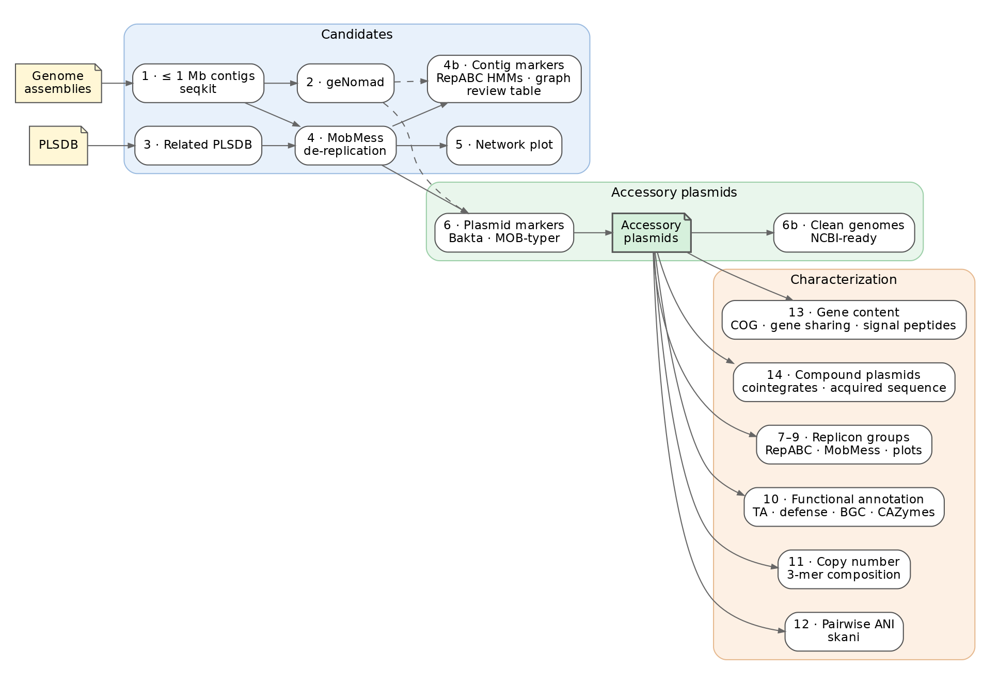

# Accessory Plasmids Identifier

This represent the commands used during my work annotating and describing novel *Sinorhizobium meliloti* accessory plasmids.
: **"Sinorhizobium meliloti Accessory Plasmidome: Characterization of Diversity, Gene Content, and Organization of Novel Large Plasmids"**

With the help of Claude, tools used were organized into a Nextflow pipeline to detect accessory plasmids in *Sinorhizobium meliloti* genome assemblies.




A more detailed diagram is in [assets/workflow.svg](assets/workflow.svg).
Both are generated with Graphviz from `assets/workflow_compact.dot` and `assets/workflow.dot`

## Contents

- [0. Genome assembly (upstream, not part of this pipeline)](#0-genome-assembly-upstream-not-part-of-this-pipeline)
- [Input](#input)
- [Usage](#usage)
- [Steps](#steps)
  - [1. Contig length filter (`seqkit seq`)](#1-contig-length-filter-seqkit-seq)
  - [2. Plasmid classification (`geNomad end-to-end`)](#2-plasmid-classification-genomad-end-to-end)
  - [3. Related PLSDB plasmids (`select_plsdb.py`, optional `mash dist`, `seqkit grep`)](#3-related-plsdb-plasmids-select_plsdbpy-optional-mash-dist-seqkit-grep)
  - [4. De-replication with MobMess (`mobmess systems`)](#4-de-replication-with-mobmess-mobmess-systems)
  - [4b. Contig markers and review of linear contigs (`pyrodigal`, `pyhmmer`)](#4b-contig-markers-and-review-of-linear-contigs-pyrodigal-pyhmmer)
  - [5. MobMess containment network (`networkx`, `ipysigma`)](#5-mobmess-containment-network-networkx-ipysigma)
  - [6. Plasmid markers (`bakta`, `mob_typer`, geNomad)](#6-plasmid-markers-bakta-mob_typer-genomad)
  - [6b. Clean genomes (`clean_genome.py`, `dnaapler`)](#6b-clean-genomes-clean_genomepy-dnaapler)
  - [7. RepABC operons and replicon groups (`repabc_operons.py`, `mmseqs easy-cluster`)](#7-repabc-operons-and-replicon-groups-repabc_operonspy-mmseqs-easy-cluster)
  - [8. MobMess on the final accessory plasmids](#8-mobmess-on-the-final-accessory-plasmids)
  - [9. Summary table and figures (`matplotlib`, `seaborn`)](#9-summary-table-and-figures-matplotlib-seaborn)
  - [10. Functional annotation (`bakta`, TASmania, `defense-finder`, `antismash`, `run_dbcan`, SignalP)](#10-functional-annotation-bakta-tasmania-defense-finder-antismash-run_dbcan-signalp)
  - [11. Replicon tags, copy number and 3-mer composition (`minimap2`, `samtools`, `kmertools`)](#11-replicon-tags-copy-number-and-3-mer-composition-minimap2-samtools-kmertools)
  - [12. Pairwise ANI between accessory plasmids (`skani dist`)](#12-pairwise-ani-between-accessory-plasmids-skani-dist)
  - [13. Gene content (`eggnog-mapper`, `panaroo`, SignalP 4.1)](#13-gene-content-eggnog-mapper-panaroo-signalp-41)
  - [14. Compound plasmids: cointegrates and acquired sequence (`cointegrates.py`)](#14-compound-plasmids-cointegrates-and-acquired-sequence-cointegratespy)
- [Parameters](#parameters)
- [Software](#software)

## 0. Genome assembly (upstream, not part of this pipeline)

The pipeline starts from genome assemblies. We recommend assembling with
[nf-core/bacass 2.6.0](https://nf-co.re/bacass/2.6.0), for example:

```bash
nextflow run nf-core/bacass -r 2.6.0 -profile singularity \
    --input bacass_samplesheet.csv --assembly_type hybrid --outdir results_bacass
```

The pipeline currently requires **Flye** assemblies: contig circularity is read from
Flye's `assembly_info.txt`. Use the **final (polished)** assembly as `assembly`: in the publication,
Nanopore assemblies were polished with Medaka (`<sample>/medaka_polish/<sample>_asm.fasta`), while PacBio HiFi
assemblies were used as produced by Flye (`<sample>/<sample>_asm.fasta`). `assembly_info` is Flye's
`assembly_info.txt` of the same assembly (contig names and circularity are unchanged by polishing).

## Input

A CSV samplesheet with one Flye assembly per sample (see `assets/samplesheet_example.csv`):

| column          | description                                              |
|-----------------|----------------------------------------------------------|
| `sample`        | unique sample name, without whitespace                   |
| `assembly`      | path to the assembly FASTA (`.fasta`, `.fa`, `.fna`, `.gz` accepted) |
| `assembly_info` | path to Flye's `assembly_info.txt` for that assembly     |
| `bam`           | optional reads mapped back to this assembly (sorted BAM), used for plasmid copy number |
| `gff`           | optional whole-genome Bakta GFF3 of this assembly, used for gene sharing (Step 13) |
| `assembly_graph` | optional Flye `assembly_graph.gfa` of this assembly, used for the graph context of linear contigs (Step 4b review) |
| `dataset`       | optional group used to colour the figures (e.g. `Penn State`, `In-house`); default `Sample`. `Database` is reserved for PLSDB plasmids |

## Usage

```bash
nextflow run accessory_plasmids -profile conda \
    --input samplesheet.csv --genomad_db /path/to/genomad_db \
    --plsdb_fasta plsdb.fasta --plsdb_nuccore nuccore.csv --plsdb_typing typing.csv \
    --bakta_db /path/to/bakta_db/db --mobsuite_db /path/to/mob_suite/databases \
    --tasmania_hmms /path/to/TASmania_HMMs --defensefinder_models ~/.macsyfinder/models \
    --antismash_db /path/to/antismash/databases --dbcan_db /path/to/dbcan_db \
    --outdir results
```

Before launching, run `export PYTHONNOUSERSITE=1`. Otherwise Python packages installed in `~/.local` (`pip install
--user`) are seen as already installed when the environments are built, and their pip dependencies (e.g. MobMess) are
not installed into the environment. The tasks themselves always run with `PYTHONNOUSERSITE=1` (`nextflow.config`).

Software is provided only through conda: always use the `conda` profile. Each step builds its own
environment from `modules/local/<step>/environment.yml` the first time it runs.
Add `slurm` to submit jobs to SLURM: `-profile conda,slurm`.

## Steps

### 1. Contig length filter (`seqkit seq`)

Keeps contigs **up to `--max_contig_len` bp each** (default `1000000`). This removes the chromosome, pSymA and pSymB, leaving candidate accessory replicons.

By default, each contig ID gets the sample name appended (`contig_4` → `contig_4_TG107`),
so IDs stay unique when contigs from many genomes are pooled. IDs that already end in `_<sample>` (e.g. renamed
or polished assemblies) are left unchanged, and only the first word of each header is kept. Turn the suffix off
with `--add_sample_suffix false`.

Samples with no contig under the threshold are reported with a warning and skipped in later steps.

Output: `results/01_contig_length_filter/`
- `<sample>.max_len_filtered.fasta`: retained contigs
- `<sample>.contig_lengths.tsv`: retained contig IDs and lengths

### 2. Plasmid classification (`geNomad end-to-end`)

Classifies each retained contig as plasmid, virus or chromosome with
[geNomad](https://github.com/apcamargo/genomad) 1.12.0, using default thresholds
(no `--relaxed`/`--conservative`). Score calibration is off (geNomad default), so
per-sample results are identical to running all contigs pooled.

The geNomad database is required (`--genomad_db`). The publication used **database v1.9**.
Download it once, outside the pipeline:

```bash
genomad download-database /path/to/
```

`download-database` always fetches the latest release. For reproducibility, check
`genomad_db/version.txt`; it is also recorded in `versions.yml`.

At this step the geNomad results are reported only; no contig is removed.

Output: `results/02_genomad/<sample>/`
- `<sample>_summary/<sample>_plasmid_summary.tsv`: contigs classified as plasmid (score, topology, hallmarks, conjugation and AMR genes)
- `<sample>_summary/<sample>_plasmid.fna`, `_plasmid_genes.tsv`, `_plasmid_proteins.faa`: plasmid sequences, genes and proteins
- `<sample>_summary/<sample>_virus_summary.tsv`, `_virus.fna`: contigs classified as virus
- `<sample>_aggregated_classification/<sample>_aggregated_classification.tsv`: chromosome/plasmid/virus scores for every contig
- `*.log`: geNomad logs

### 3. Related PLSDB plasmids (`select_plsdb.py`, optional `mash dist`, `seqkit grep`)

Collects public plasmids related to *S. meliloti* from [PLSDB](https://doi.org/10.1093/nar/gkae1095)
(publication: version 2024_05_31_v2). They are pooled with the sample contigs for de-replication in the next step.

A PLSDB record is selected if:
1. **Metadata (always):** `--plsdb_keyword` (default `meliloti`, case-insensitive) appears in the
   MOB-typer nearest-neighbour species (`mash_neighbor_identification`) or in the record description
   (`NUCCORE_Description`). With PLSDB 2024_05_31_v2 this gives the 224 records used in the publication.
2. **Mash (optional, `--plsdb_mash`):** a PLSDB plasmid is within `--mash_max_dist` and `--mash_max_pvalue`
   of any filtered contig (`mash dist -i` against the PLSDB sketch).

No length filter is applied to PLSDB records: megaplasmid-sized records (e.g. pSymA/pSymB) must stay in so
that clusters containing them can be discarded during de-replication.

All PLSDB inputs are files distributed with PLSDB: the sequences FASTA, `nuccore.csv` (record metadata)
and `typing.csv` (MOB-typer results). The two tables are joined on `NUCCORE_ACC`; their rows are not in the
same order. The run stops if an accession is duplicated or missing from `typing.csv`.

Output: `results/03_plsdb_related/`
- `plsdb_related.fasta`: selected PLSDB plasmids, headers trimmed to the accession
- `plsdb_related.circular.tsv`: `accession<tab>1/0` (circular/linear), used by MobMess
- `plsdb_related.sources.tsv`: why each record was selected (`metadata`, `mash` or both)
- `plsdb_related.ids.txt`: selected accessions
- `<sample>.mash_dist_plsdb.tsv`: Mash hits (only with `--plsdb_mash`)

### 4. De-replication with MobMess (`mobmess systems`)

Sample contigs (Step 1) and related PLSDB plasmids (Step 3) are pooled, sorted by ID and clustered with
[MobMess](https://doi.org/10.1038/s41564-024-01610-3) (default 90% identity and 90% coverage).
Circularity comes from Flye's `assembly_info.txt` (`circ.` column) for sample contigs and from
`NUCCORE_Topology` for PLSDB plasmids. The run stops on duplicated IDs or if any sequence lacks circularity.

Clusters are then kept only if they look like real plasmids:

| MobMess cluster type    | kept when                                                              |
|-------------------------|------------------------------------------------------------------------|
| `fragment`              | never                                                                  |
| `backbone`              | all members < `--mobmess_max_len`                                      |
| `compound`              | all members < `--mobmess_max_len` and at least one circular member     |
| `maximal_not_in_system` | as `compound`, plus at least one member is a sample contig (not PLSDB) |

Clusters made only of PLSDB plasmids are kept when they are `backbone` or `compound`: MobMess places
them in plasmid systems, so their relationship to *S. meliloti* plasmids is established. A PLSDB-only
`maximal_not_in_system` cluster is related only through the PLSDB annotation used to select it,
so it is discarded.

Output: `results/04_mobmess/`
- `<sample>.circular.tsv`: circularity of each sample's filtered contigs
- `<sample>.coverage.tsv`: Flye read depth of each filtered contig, and relative to the chromosome
- `mobmess_input.fasta`, `mobmess_input.circular.tsv`: pooled MobMess input
- `mobmess_clusters.txt`, `mobmess_systems.txt`, `mobmess_contigs.txt`, `mobmess_ani*.txt`, `*_graph.*`: MobMess output
- `mobmess.filtered_clusters.tsv`: clusters that passed, with `length` and `source` (`sample`/`plsdb`)
- `mobmess.filtered.fasta`, `mobmess.filtered_ids.txt`: sequences that passed

### 4b. Contig markers and review of linear contigs (`pyrodigal`, `pyhmmer`)

Before MobMess, every filtered contig of every sample is searched for RepABC genes without a full
annotation: genes are predicted with pyrodigal (metagenomic mode) and the proteins (>= 200 aa) searched
with pyhmmer against four HMMs shipped in `assets/repabc_hmms.hmm`, each with its gathering (GA)
threshold:

| model | source | gene |
|---|---|---|
| TIGR03453 `partition_RepA` | TIGRFAMs 15.0 | repA |
| TIGR03454 `partition_RepB` | TIGRFAMs 15.0 | repB |
| PF03428 `RP-C` (N-terminal), PF11800 `RP-C_C` (C-terminal) | Pfam 35.0 | repC |

The operons are then called with the publication rules (`repabc_operons.py`, Step 7). A truncated
RepA/RepB (pseudogene) falls below the GA threshold and does not complete an operon.
On the 423 published accessory plasmids this gives 396 complete operons, against 390 from the
Bakta gene names with the same rules. 387 agree. The HMMs complete 9 operons whose RepA/RepB
Bakta named only generically (e.g. "AAA domain-containing protein", "Soj", "hypothetical protein").
They do not complete 3 whose RepA or RepB is a truncated pseudogene. On the reference genome they
find no RepABC genes on the chromosome, one complete operon on pSymA, and on pSymB one complete
operon plus a RepA-RepB pair.

`contig_markers.tsv` has one row per filtered sample contig: sample, dataset, length, circular, the
number of contigs and of circular contigs in the whole assembly (Flye `assembly_info.txt`), RepA/RepB/RepC
counts, operon, geNomad plasmid score / hallmarks / conjugation genes, coverage relative to the
chromosome, MobMess cluster and type (with the number of circular members), whether the MobMess filter
kept it, and the replicon tag (Step 11, with `--reference_genome`).

With an `assembly_graph` column, each contig also gets its Flye assembly-graph context: the graph
component (connected S/L segments of `assembly_graph.gfa`, mapped to contigs through `graph_path` in
`assembly_info.txt`), the other contigs in it (named by replicon tag when available), and its repeat
edges (used more than once on its path, or >= 1.8x its depth).

`linear_marker_review.tsv` lists linear contigs, not tagged as chromosome / pSymA / pSymB, for user review:
- **A**: at least one RepABC gene, and dropped by the MobMess filter (Step 4);
- **B**: a plasmid marker (at least one RepABC gene, or a geNomad plasmid call with at least one hallmark gene
  or, without hallmarks, a score >= `--review_genomad_score`, 0.9), and the graph component
  holds no main replicon: alone, or only with other non-main contigs (without replicon tags: alone). Kept or
  dropped by the filter. Typically a complete replicon that Flye could not circularize because of repeats.
  There is no length threshold: small plasmids are real too (the final set has the 7.5 kb `contig_8_TG17`),
  so the markers decide.

Graph connections are reported, not used to exclude: a contig connected to the chromosome is likely a
fragment or an integrated element, while a connection to pSymA/pSymB is ambiguous. Flagged contigs are
not added back automatically, and no reassembly is attempted. A typical case is a plasmid that is linear in every assembly carrying it, so its
cluster has no circular member: in the publication data, `contig_1_TG62` (225 kb, complete RepABC
operon) was dropped this way: it is alone in its graph component (225 kb, 39x vs 34x chromosome) and its
path runs several times through repeat edges at up to 13.5x its depth. In a 6-genome subset run it is
flagged by A and B. So are `contig_3_TG10` and `contig_6_TG70`, whose circular relatives (cluster 277)
are not in the subset. `contig_5_TG70` (20 kb, sharing repeats with `contig_6_TG70` away from the main
replicons) is flagged by B only.

Output: `results/04_contig_markers/`
- `repabc_hmm/`: `<sample>.repabc.tsv` (RepABC genes, Bakta layout), `<sample>.hits.tsv` (all HMM hits),
  `<sample>.summary.tsv` (operons), `<sample>.assembly_stats.tsv`, `<sample>.contig_info.tsv`
- `assembly_graph/`: `<sample>.graph.tsv`
- `contig_markers/`: `contig_markers.tsv`, `linear_marker_review.tsv`

### 5. MobMess containment network (`networkx`, `ipysigma`)

Interactive plot of the MobMess containment network with **all** clusters, before filtering
(publication Fig. S2A). Nodes are sequences, edges are containment relationships. Nodes are coloured
by MobMess cluster type (backbone, compound, maximal, fragment) and sized by length. Hovering over a
node shows its attributes:

| attribute       | description                                                       |
|-----------------|-------------------------------------------------------------------|
| `length`, `gc`  | sequence length (bp) and GC % (G+C over length)                    |
| `source`        | `sample` or `plsdb`                                               |
| `genomad`       | `plasmid` / `not_plasmid` (Step 2); `not_tested` for PLSDB plasmids |
| `passed_filter` | `1` if the sequence passed the MobMess cluster filter (Step 4)    |

The layout (ForceAtlas2) is computed in the browser when the HTML file is opened, so it can differ slightly
between openings.

Output: `results/05_network/`
- `mobmess_network.html`: interactive network (open in a web browser)
- `mobmess_network.graphml`: annotated graph, e.g. for Gephi or Cytoscape
- `mobmess_network.nodes.tsv`: node attribute table

### 6. Plasmid markers (`bakta`, `mob_typer`, geNomad)

Sequences that passed the MobMess filter (Step 4) are annotated in one [Bakta](https://doi.org/10.1099/mgen.0.000685)
run (`--keep-contig-headers`) and typed with [MOB-typer](https://doi.org/10.1099/mgen.0.000206) (`--multi`).
A sequence is kept as an accessory plasmid when:

1. Bakta annotates a **replication or partition protein**: product matching, case-insensitive,
   `(?:^(?:(?:plasmid[\s/_-]*)?replication)|partition|para\s|parb\s)` (e.g. RepA/B/C, ParA, ParB); or
2. geNomad (Step 2) reports a **MOB relaxase** among its conjugation genes. This rescues plasmids without an
   annotated replication protein, such as a MOBV plasmid made mostly of hypothetical proteins.
   PLSDB plasmids are not run through geNomad, so only rule 1 applies to them.

Sequences listed in `--feature_exclude` (one ID per line, `#` comments allowed) are removed after manual
curation. `assets/feature_exclude_publication.txt` holds the exclusion used in the publication.
MOB-typer results are reported but are not used to decide.

**Review flag.** Small plasmids are usually high-copy. A kept sample plasmid shorter than `--flag_max_len`
(default 50 kb) whose Flye read depth is below `--flag_min_rel_cov` (default 0.5) times the depth of its
chromosome (largest contig of the assembly) gets `review_flag = low_coverage_small`. The flag does not
remove anything: low depth can mean contamination, plasmid loss or a mixed culture, so check flagged
plasmids and add them to `--feature_exclude` if needed. In the publication data, contig_8_TG153 (14.3 kb,
0.28x) was excluded this way, and contig_5_TG24 (44 kb, ParB, 0.35x) is flagged but was kept.

Output: `results/06_plasmid_features/`
- `plasmid_features.features.tsv`: one row per sequence with its markers, Flye `depth` and `rel_coverage`,
  `keep` (1/0), `reason` (`rep_partition`, `genomad_mob`, `excluded`, `no_marker`) and `review_flag`
- `plasmid_features.rep_proteins.tsv`: Bakta features matching the replication/partition pattern
- `plasmid_features.fasta`, `plasmid_features.ids.txt`: accessory plasmids kept
- `bakta/`: Bakta annotation (`.tsv`, `.gff3`, `.gbff`, `.faa`, ...)
- `mob_typer/`: MOB-typer reports
- `plasmid_features.circular.tsv`: circularity of the kept plasmids (input of Step 8)

### 6b. Clean genomes (`clean_genome.py`, `dnaapler`)

With `--reference_genome` (replicon tags, Step 11), one clean genome per strain for NCBI submission and later
analyses: `results/06b_clean_genomes/<sample>.clean.fasta`.

| sequence | rule | FASTA header (NCBI source modifiers) |
|---|---|---|
| chromosome | tag Chromosome | `[location=chromosome]` |
| pSymA, pSymB | tags pSymA / pSymB | `[plasmid-name=pSymA]` / `[plasmid-name=pSymB]` |
| accessory plasmids | final accessory set (Step 6) | `[plasmid-name=p<strain><a,b,…>]`, letters by decreasing length |
| unplaced | `<replicon>_fragment` tags and Step 4b review contigs | no location / name |

All sequences get `[topology=circular|linear]` (Flye); circular chromosome and plasmids also get
`[completeness=complete]`. Everything else (debris, IS circles, contigs not retained) goes to
`<sample>.removed.fasta`, each with its reason. An optional curation table (`--curation`: sample, contig,
action `keep|drop`, name, note) overrides any decision. `keep` with a name starting with `p` makes a named
plasmid, `keep` without a name an unplaced contig.

Circular replicons are re-oriented. The chromosome starts at *dnaA* (dnaapler `chromosome`). pSymA, pSymB and
the accessory plasmids start at the RepA of their RepABC operon, found with the RepABC HMMs (Step 4b): the
RepA of a complete operon, else the best-scoring RepA, reverse-complemented when on the minus strand.
dnaapler's own RepA database finds none of these RepABC-type RepA proteins. A custom RepA database is not
used either, because dnaapler requires the hit to cover the first residue of the reference protein, and the
chromosome carries ParA-like RepA paralogs. Linear contigs, unplaced contigs and plasmids without RepA keep
their assembled orientation.

`clean_genomes_summary.tsv` has one row per strain: replicon sizes, accessory plasmids (circular), unplaced
and removed contigs, total size and notes (missing or linear replicons; no pSymB with a > 5 Mb chromosome =
possible chromosome–pSymB fusion, e.g. AVT35, AVT110, TG70: the fused molecule is kept whole as the
chromosome). `<sample>.clean.tsv` gives the role and reason of every contig, and `<sample>.rotation.tsv`
the re-orientation applied.

### 7. RepABC operons and replicon groups (`repabc_operons.py`, `mmseqs easy-cluster`)

**RepABC operons.** Among the Bakta replication/partition features of the kept plasmids, those whose product
matches `[rR]ep[ABC]` are scanned from each *repA*: 4 kb downstream (+ strand) or upstream (− strand). A window
holding *repA*, *repB* and *repC* is a complete operon. With the publication data this gives 403 plasmids with
*repA* and 394 with a complete operon. `--repabc_wrap_circular true` also lets windows wrap around the origin
of circular plasmids (398 complete operons; the representative RepA set does not change).

**Representative RepA.** A plasmid is typed only when it has exactly one *repA*: the one of its complete operon,
or its single *repA* (401 plasmids in the publication).

**Replicon groups.** Following [Cavassim *et al.* (2020)](https://doi.org/10.1099/mgen.0.000351), representative
RepA proteins are clustered together with the eight *Rhizobium leguminosarum* reference RepA
(`assets/Rh_repA_replicons.fasta`, groups Rh01–Rh08) using MMseqs2 (`--min-seq-id 0.9 -c 0.7`).
A cluster with a reference takes its name; other clusters are named Si01, Si02, ... by decreasing size.
Equal-sized clusters have no natural order, so `--replicon_names` (sequence `<tab>` group) keeps earlier
names: a cluster takes the listed name held by most of its members, and new clusters get the next Si number.
`assets/replicon_group_names_publication.tsv` reproduces the publication's groups exactly.

Output: `results/07_replicon_groups/`
- `repabc.summary.tsv`: per plasmid, rep genes found, complete operon (1/0) and representative RepA locus
- `repabc.operons.tsv`: the rep features behind each call
- `repA.replicon_groups.tsv`: plasmid, RepA locus, replicon group, cluster representative and group size
- `repA.faa`, `repA_clust_cluster.tsv`, `repA_clust_rep_seq.fasta`: RepA proteins and MMseqs2 clusters

### 8. MobMess on the final accessory plasmids

MobMess is run again (as in Step 4) on the plasmids kept in Step 6 only, so clusters and plasmid systems
reflect the final set. Cluster IDs differ from Step 4.

Output: `results/08_mobmess_final/`: `mobmess_final_clusters.txt`, `mobmess_final_systems.txt`, graphs, etc.

### 9. Summary table and figures (`matplotlib`, `seaborn`)

One table and four figures (PNG and SVG) of the accessory plasmids. Plasmids are coloured by the samplesheet
`dataset` column; PLSDB plasmids are `Database` (grey).

| file | content |
|------|---------|
| `plasmid_summary.tsv` | one row per accessory plasmid: sample, dataset, length, MobMess cluster, replicon group, RepABC, MOB-typer, geNomad, coverage and review flag |
| `features_stackbar` | % of plasmids per relaxase type, MPF type, predicted mobility, host range (top 8) and rep genes |
| `rep_proteins_heatmap` | replication/partition proteins per plasmid; rows clustered (Hamming distance, average linkage) and coloured by dataset |
| `replicon_groups_by_dataset` | plasmids per replicon group, stacked by dataset |
| `replicon_multiplicity_length` | length of plasmids with single vs duplicated RepA/B/C, with a Mann-Whitney U test |
| `replicon_cooccurrence_upset` | UpSet plot of replicon groups carried together by the same strain (sample plasmids with a replicon group) |
| `plasmids_per_strain` | strains by number of accessory plasmids (strains with at least one; all accessory plasmids) |

Percentages in `features_stackbar` are per plasmid (all accessory plasmids), whereas the publication notebook
counted one row per rep gene of plasmids carrying RepA.

Output: `results/09_summary/`

### 10. Functional annotation (`bakta`, TASmania, `defense-finder`, `antismash`, `run_dbcan`, SignalP)

Each accessory plasmid (Step 6) is annotated **on its own** with Bakta, as in the publication, so a plasmid's
genes do not depend on which other plasmids are in the run. The per-plasmid annotations are merged
(proteins renamed `<locus>__<plasmid>`) and searched for:

| feature | tool | settings |
|---------|------|----------|
| Toxin-antitoxin genes | [TASmania](https://doi.org/10.1371/journal.pcbi.1006946) HMMs with pyhmmer `hmmsearch`, scored like TASer | see below |
| Defense / anti-defense systems | [DefenseFinder](https://doi.org/10.1038/s41467-022-30269-9) 3.0.0 | per plasmid; `--db-type ordered_replicon --coverage 0.4 --antidefensefinder` |
| Biosynthetic gene clusters | [antiSMASH](https://doi.org/10.1093/nar/gkaf334) 8.0.4 | all plasmids in one run; `--cb-general --cc-mibig --taxon bacteria`; genes from Bakta |
| CAZymes | [run_dbcan](https://doi.org/10.1093/nar/gkad328) 5.2.9 | `--methods` `--dbcan_methods`; kept if found by ≥ `--cazyme_min_tools` (2) tools |
| Signal peptides of CAZymes (optional) | SignalP 6.0 (fast, organism other) | only with `--signalp_module` and `--signalp_model_dir` |

**Toxin-antitoxin (TASer-like).** The publication used the [TASer web server](https://shiny.bioinformatics.unibe.ch/apps/tasmania/),
which also reports whether each gene is a toxin or antitoxin and its pseudo-operon structure (e.g. `TA`, `xTA`,
`Ax`). TASer can only be run on its web page, so the pipeline reproduces its method locally. The rules were
inferred from the publication's TASer reports:
- genes are predicted with Prodigal (pyrodigal, single mode) **trained on all plasmids of the run**, as TASer
  does on a submission (this reproduces 100% of TASer's gene coordinates for the same submission). TASer
  calls its own genes, and Bakta misses some small TA genes;
- each protein is scored alone against the TASmania HMMs (E-values with Z = 1), so E-values do not depend on how
  many plasmids are analysed;
- each gene keeps its best HMM and is reported at E < `--ta_report_evalue` (0.01);
- T (toxin) / A (antitoxin) comes from the TASmania HMM (`T.<id>` / `A.<id>`);
- pseudo-operons are genes on the same strand with intergenic distance −100 to +100 nt; the structure lists them
  in genomic order as T, A or x (no TA hit).

Each TA gene is linked to the Bakta gene it overlaps (≥ 50% of both lengths) for its name and product. Counts
(as in the publication notebook) use genes with E < `--ta_evalue` (1e-3) that are not RepA/B/C proteins.

Agreement with the publication's TASer reports:

| run | TASer genes found | same T/A and HMM | same operon structure |
|-----|-------------------|------------------|-----------------------|
| same submissions as TASer (6 batches of ~70 plasmids) | 3,493 / 3,494 | 100% | 94–99.6% |
| all plasmids in one run (as the pipeline does) | 3,347 / 3,494 (95.8%) | 100% | 95.1% |

Gene training depends on which plasmids are in the run, so a few gene calls change with the plasmid set. With
less than 100 kb of plasmid sequence in total, Prodigal cannot be trained and metagenome mode is used instead.
E-values are about 5% lower than TASer's (HMMER 3.4 vs 3.1). TASer also adds a `?` at the edge of some operons,
mostly next to a contig end; its meaning is not documented and it is not reproduced.

**dbCAN tools.** In the publication the CAZy DIAMOND search returned no output, so in practice both dbCAN-HMM
and dbCAN-sub had to agree. The pipeline runs all three tools and stops if DIAMOND produces nothing. With the
publication data, DIAMOND adds 10 CAZymes (759 instead of 749) and no new plasmid (339). Use
`--dbcan_methods hmm,dbCANsub` to reproduce the published set exactly.

**SignalP** is licensed and cannot be installed by conda. On a cluster with an environment module, run with e.g.
`--signalp_module signalp/6.0-fast --signalp_model_dir /path/to/signalp-6-package/models/`.

The whole step is skipped with `--skip_annotation`.

Output: `results/10_annotation/`
- `annotation_summary.tsv`: per plasmid, number of TA genes, complete TA pseudo-operons (toxin + antitoxin) and their
  structures, defense systems (and types), BGC regions (and types), CAZymes (and families)
- `tasmania.genes.faa` (Prodigal proteins), `tasmania.hits.csv` (all HMM hits), `tasmania.ta.tsv` (TA genes: T/A,
  best HMM, E-value, operon ID and structure, overlapping Bakta gene/product, `count` = used in counts)
- `defense_systems.tsv` (all plasmids), `defensefinder/<plasmid>_defense_finder_{systems,genes,hmmer}.tsv`
- `bgc_regions.tsv` (region and product per plasmid), `antismash/` (full antiSMASH output)
- `cazymes.tsv`, `cazymes_signalp.tsv`, `dbcan/` (run_dbcan output), `signalp/` (if run)
- `plasmids.tsv`, `plasmids_proteins.faa`, `plasmids.gbff` (merged annotation), `bakta/<plasmid>/` (per plasmid)
- Figures: `ta_heatmap_per_plasmid`, `ta_heatmap_per_cluster`, `ta_operon_structures`, `defense_heatmap_per_cluster`,
  `bgc_types`, `cazyme_families`

### 11. Replicon tags, copy number and 3-mer composition (`minimap2`, `samtools`, `kmertools`)

Runs when `--reference_genome` is given (publication: *S. meliloti* GCF_037023865.1).

**Replicon tags.** Each assembly is aligned to the reference (`minimap2 -x asm5 --end-bonus 100 --secondary=no`).
Each contig keeps its longest alignment block, and each reference replicon (`--reference_tags`: chromosome, pSymA,
pSymB) is given to the single contig with the longest block; other contigs are `Other`. This is the publication
rule and reproduces its tags for all 346 strains. As a safeguard, a tag is kept only if the contig covers at least
`--tag_min_ref_cov` % (30) of the replicon. Without it, when a replicon is fused to another (e.g. chromosome +
pSymB), the tag slides to an unrelated contig: in the publication, two plasmids were tagged pSymB while covering
< 1% of pSymB (all other tags cover ≥ 41%). `--tag_min_ref_cov 0` reproduces the publication exactly.

**Copy number** (samples with a `bam` in the samplesheet). Copy number = median per-base read depth of the plasmid /
median depth of the chromosome (`samtools depth -a`; 1 kb ignored at each contig end). pSymA and pSymB are reported
as a sanity check (expected ≈ 1). Reproduces the publication's values exactly.

**3-mer composition.** Accessory plasmids (Step 6, PLSDB excluded) and all main replicons are compared by
[Kmertools](https://github.com/anuradhawick/kmertools) 3-mer frequencies (32 canonical 3-mers), Bray-Curtis
distances and a UMAP (random_state 42). Length and GC of accessory plasmids are compared with each main replicon
type (two-sided Mann-Whitney U, Bonferroni).

Output: `results/11_replicons/`
- `tags/<sample>.replicon_tags.tsv`: tag, length, best reference replicon and its coverage, per contig
- `copy_number.tsv` (all samples), `copy_number/<sample>.copy_number.tsv`
- `kmer/kmer_3mer_frequencies.tsv`, `kmer/kmer_umap.tsv`, `kmer/kmer_stats.tsv`; figures `kmer_umap`, `replicon_length`, `replicon_gc`

**Fragments.** The publication rule gives each reference replicon to a single contig, so the other pieces of a
replicon split into several contigs stayed `Other` (e.g. AVT83: pSymA in an 840 kb and a 722 kb contig; the
722 kb piece was tagged `Other`). A contig not given a replicon is now tagged `<replicon>_fragment` (e.g.
`pSymA_fragment`) when >= `--tag_fragment_min_frac` (0.65) of its length aligns to that replicon and the aligned
length is >= `--tag_fragment_min_aligned` (50 kb). Calibrated on all 340 assemblies (minimap2 as above): no
final accessory plasmid passes (maximum 55.6%, `contig_5_TG159` against pSymB; most < 10%). The large replicon
pieces (415-935 kb) are >= 69%. The length limit keeps out IS elements, 2-13 kb contigs with copies on pSymA or
the chromosome. This gives 8 fragments (6 chromosome, 2 pSymA). Fragments count for their replicon in gene
sharing (Step 13), are treated as main-replicon pieces in the Step 4b review, and are not added to
`main_replicons.fasta` (one sequence per replicon for the 3-mer composition, as in the publication).

### 12. Pairwise ANI between accessory plasmids (`skani dist`)

All accessory plasmids (Step 6) are compared all-vs-all with [skani](https://doi.org/10.1038/s41592-023-02018-3)
(default settings). Each plasmid is written to its own FASTA first: this reproduces the publication's values exactly,
whereas `--qi/--ri` on one multi-FASTA changes ~4% of them. The alignment fraction of each pair is that of the
longer plasmid, `AF = min(Align_fraction_ref, Align_fraction_query)` (publication Fig. S2D).

Output: `results/12_plasmid_ani/`
- `skani_dist.tsv`: skani output; `plasmid_ani.tsv`: pairs (self-comparisons removed) with `AF`
- `ani_vs_af`: hexbin density of AF vs ANI

### 13. Gene content (`eggnog-mapper`, `panaroo`, SignalP 4.1)

Needs the Step 10 annotation. Three parts, each optional:

**A. COG analysis of accessory plasmids** (with `--eggnog_db`). The accessory plasmid proteins are annotated with
[eggNOG-mapper](https://doi.org/10.1093/molbev/msab293) 2.1.13 (`-m mmseqs`, eggNOG database 5.0.2 in the publication).
Then, as in the publication notebook:
- COG category counts (each letter of a multi-letter category counted once);
- gene content: presence/absence of the root eggNOG orthologous group per plasmid, Jaccard distances, PCoA and
  metric MDS, coloured by the 10 largest MobMess clusters (clusters with ≥ 5 plasmids);
- COG enrichment per MobMess cluster with more than `--cog_min_cluster` (3) plasmids: one-sided Fisher exact test
  (cluster vs all other plasmids) on the number of plasmids carrying each COG letter, Benjamini-Hochberg over all
  tests; significant at FDR < 0.05 and log2FC > 0.2;
- COG composition per cluster (clusters with ≥ `--cog_min_cluster` plasmids; note: ≥ here, > for the enrichment, as in
  the publication), row z-scores.

On the publication's eggNOG output this reproduces the notebook's enrichment exactly (440 tests, 21 significant).

**B. Gene sharing with the main replicons** (with `--gene_sharing`, `--reference_genome` and a `gff` column in the
samplesheet: the whole-genome Bakta GFF3 of each assembly). [Panaroo](https://doi.org/10.1186/s13059-020-02090-4) 1.6.0
(`--clean-mode moderate --remove-invalid-genes`) is run on the whole genomes plus one standalone GFF per accessory plasmid
(Step 10). Gene families are assigned to accessory plasmids only through the standalone plasmid GFFs, and to the
chromosome / pSymA / pSymB through the genome GFFs and the Step 11 tags (genes on accessory-plasmid contigs skipped,
so nothing is counted twice). On the publication's Panaroo output this reproduces `family_group_membership.csv`
exactly and 34.6% of accessory-plasmid families shared with a main replicon. Panaroo on hundreds of genomes needs
a large node (`process_panaroo`: 32 CPUs, 100 GB, 72 h; the publication used 70 CPUs).

Output: `results/13_gene_content/`
- `eggnog_mapper/plasmids_eggnog.emapper.*`
- `cog_analysis/`: `cog_counts.tsv`, `og_presence_absence.tsv`, `cog_ordination.tsv`, `cog_enrichment.tsv` (all tests),
  `cog_enrichment_significant.tsv`; figures `cog_counts`, `cog_pcoa`, `cog_mds`, `cog_enrichment_dotplot`, `cog_cluster_heatmap`
- `panaroo/`: Panaroo output
- `gene_sharing/`: `family_group_membership.csv`, `gene_sharing_summary.tsv`, `shared_families_cog.tsv`;
  figures `gene_sharing_upset`, `shared_families_cog`
- `panaroo_plasmids/`, `signalp4/`, `signal_peptides/`: see C below

**C. Signal peptide-bearing protein families** (with `--signalp4_module`; publication Fig. 9D). SignalP 4.1
(`-t gram- -s notm`) is run on all accessory plasmid proteins. SignalP is licensed and not on conda, so it is loaded
as an environment module (at Stowers: `--signalp4_module spada/1.0`, which provides `signalp4`). Nextflow loads it with
`module load`, so the `module` command must exist in the job shell (it does on SLURM nodes; for local runs start
Nextflow from a login shell). The hits are linked
to the gene families of a second, plasmid-only Panaroo run (`PANAROO_PLASMIDS`, same options as B, as the
publication's `pan_plasmidome_panaroo`). As in the notebook:
- plasmids/clusters with a signal-peptide protein in a family that is not conjugation-related (`conjuga`);
- family ranking: CAZymes (Step 10, ≥ `--cazyme_min_tools`) removed, families ranked by the number of plasmids,
  conjugation-related products dropped, each family labelled with the product of its longest member; the top
  `--signalp_top` (15) are plotted.

On the publication's SignalP 4.1 and Panaroo outputs this reproduces the notebook: 5,759 signal-peptide proteins,
615 families, 395 plasmids in 138 of 148 clusters (93%), and the same family ranking (ties are kept in a stable order).
On a 200-protein test, `signalp4` from the module gave exactly the published hits.

Output (`results/13_gene_content/`): `signalp4/` (`signalp4.summary`, `.mature.fasta`, `.short`),
`panaroo_plasmids/`, `signal_peptides/`: `signal_peptide_proteins.tsv`, `signal_peptide_families.tsv`,
`signal_peptide_summary.tsv`, figure `signal_peptide_families`

### 14. Compound plasmids: cointegrates and acquired sequence (`cointegrates.py`)

Needs the Step 10 annotation. Uses the **first MobMess run (Step 4)**, whose cluster IDs are the ones in the
publication, restricted to the final accessory plasmids. For every plasmid in a MobMess **compound** cluster, the
**parents** are the plasmid backbones of its systems. For each system, the circular backbone member covering most of
the compound is taken from MobMess's alignment blocks (`*_ani_blocks.txt`). It is kept as a parent when it is
>= `--partner_min_len` (20 kb) and its covered region carries a replication gene. Backbones that are not plasmids
(the ~3 kb IS circles and NRPS-derived contigs of many systems) are listed but not used as parents.

- **Cointegrate**: two parents from different systems that each cover >= `--cointegrate_min_part` (0.2) of the
  compound, overlap by <= `--cointegrate_max_overlap` (0.2) and together cover >= `--cointegrate_min_union` (0.8).
  The mobile-element genes within `--junction_window` (5 kb) of the junctions are listed.
- **Extra sequence**: computed **per parent system**. For each compound and each of its plasmid parents, every region
  >= `--segment_min_bp` (5 kb) not present in that parent. Parents are never merged, so a region one parent lacks but
  another parent carries is kept (`in_other_parents` gives the share of the region found in each other parent). A
  compound with two parent systems therefore gets two rows in the summary and map. Its content is read from
  several sources and reported as hints, since ICE / IME / phage annotations are not well established.

#### How each label is assigned

**Step 1. Evidence ("hints") in each region.** A gene counts for a region when >= 50% of its length lies inside
the region. Genes within `--junction_window` (5 kb) of a region end but outside it are listed with `(end)` in the
`integrase` / `transposase` columns and **never** set the class.

| hint | accepted when | sources and exact rules | column(s) |
|---|---|---|---|
| **replication (Rep)** | one HMM hit, **or** MOB-typer and Bakta agree on the same gene | RepABC HMM (Step 4b: RepA / RepB / RepC, Pfam/TIGRFAM gathering cut-offs) is accepted alone. A MOB-typer `replicon` hit is accepted only when it overlaps (>= 50% of the hit) a Bakta CDS whose product matches `replication\|replicase\|\brep[A-Z]?\b`. A MOB-typer hit without that support is listed but not used. Bakta names alone are never used | `replication`, `replication_unconfirmed` |
| **relaxase (MOB)** | any one source | MOB-typer `relaxase` or `oriT`; geNomad CONJscan `MOB*`; Bakta product matching `relaxase\|mobilization\|\bmob[A-Z]\b` | `relaxase` |
| **MPF** | **>= 2 of the 3 tools** report MPF in the region (any genes) | MOB-typer `mate-pair-formation`; geNomad CONJscan non-MOB components (`T_virB*`, `F_tra*`, `I_tra*`, …); Bakta product matching `type IV secret\|conjugal\|conjugative transfer\|\bTra[A-Z]\b\|\bTrb[A-Z]\b\|\bVirB` that is not a relaxase (so TraA is not MPF) | `MPF` (all hits), `MPF_sources`, `MPF_accepted` |
| **integrase** | any Bakta gene inside | Bakta product matching `integrase\|site-specific (DNA) recombinase\|recombinase`, excluding `resolvase\|Tn3` | `integrase` |
| **phage** | a provirus, or >= 2 phage genes | geNomad provirus with >= 50% of it inside the region; or >= 2 genes that are geNomad virus hallmarks or Bakta virion genes (`terminase`, `capsid`, `portal protein`, `tail …`, `baseplate`, `prohead`, `head-tail`, `holin`, `virion`) | `phage` |
| transposase | listed only | Bakta product matching `transposase\|insertion sequence/element\|\bIS\d`, plus resolvases / Tn3 | `transposase` |

**Step 2. Class: the first rule that matches.**

| # | class | rule | meaning |
|---|---|---|---|
| 1 | **phage-plasmid** | Rep + phage | a phage-plasmid carried into the compound |
| 2 | **Rep and Integrase** | Rep + integrase | a second plasmid carrying an integrase, or an integrative element carrying a Rep (not resolved) |
| 3 | **Rep (second parent absent)** | Rep, and no other MobMess sequence covers >= 80% of the region | sequence from a second plasmid that is not in the dataset. The first parent (the backbone) always is |
| 4 | **Rep (second parent present)** | Rep, and another sequence covers >= 80% of the region | the probable second parent is in the dataset (`best_match`) |
| 5 | **ICE-like** | integrase + relaxase + MPF (accepted) | integrative and conjugative element |
| 6 | **IME-like** | integrase + relaxase | integrative and mobilizable element |
| 7 | **MOB/MPF** | relaxase and/or MPF (accepted), not meeting 5-6 | mobilization / conjugation module |
| - | *unclassified* (empty) | none of the above | hints still listed; an integrase or a transposase alone is not a class |

**Caveats when reading the labels.**
- Rep always wins: a region with a Rep and an integrase is "Rep and Integrase" even when it also has a relaxase.
- The MPF rule counts **tools, not genes**. Two tools that hit the same gene meet it.
- A MOB-typer `MPF_<type>` label names the conjugative-system type of the reference protein it matched. It does not
  show that a complete mating-pair channel is present. Example: the 59 kb module of cluster 164 is ICE-like on a
  single gene (HOBFBD_0119 in contig_1_TG65, 307 aa; Bakta "type IV secretory system conjugative DNA transfer family
  protein"). That gene matches residues 1-272 of a 554-aa MOB-typer `MPF_T` reference (83% identity), and CONJscan
  finds no MPF component in the region. The same module in contig_7_TG123 (cluster 201), where only Bakta reports
  MPF, is IME-like.
- ICE / IME / phage labels are hints from gene annotations, not verified element boundaries. Check the hint columns
  and `extra_segment_genes.tsv` before interpreting a region.

The best match among the other MobMess sequences (the compound's other parents included; this parent, the same
cluster and sequences containing the whole plasmid skipped) and `source_in_dataset` (>= 80% of the region) show
whether the extra sequence exists elsewhere in the data.

On the publication's MobMess output, 44 of the 169 compound accessory plasmids (24 clusters) have a plasmid parent,
giving 56 compound-parent pairs and 89 extra regions:

| class | regions | clusters | median size | source in dataset | in another parent (>= 80%) |
|---|---|---|---|---|---|
| Rep and Integrase | 17 | 8 | 68 kb | 8 | 9 |
| MOB/MPF | 16 | 4 | 28 kb | 11 | 0 |
| ICE-like | 5 | 2 | 59 kb | 0 | 0 |
| Rep (second parent present) | 5 | 1 | 44 kb | 5 | 5 |
| Rep (second parent absent) | 2 | 2 | 68 kb | 0 | 0 |
| IME-like | 1 | 1 | 59 kb | 0 | 1 |
| unclassified | 43 | 13 | 17 kb | 31 | 17 |

- Cluster 381 (both members) is the only cointegrate (parents: clusters 364 and 380). Against each parent, the
  region it lacks is the other parent's half (Rep and Integrase, 98-100% in the other parent). The junction genes
  include the four Tn3 genes of the publication's clinker figure (Fig. 5B).
- Mosaics of related backbones (clusters 201 and 345) are no longer hidden: contig_7_TG123
  (cluster 201) lacks a 15 kb IS-flanked sulfur-metabolism cassette relative to PS25 (TG85) that PS22 (TG164)
  carries, and a 59 kb IME-like module (MOBQ relaxase, T4CP, integrases) relative to PS22 that PS25 carries. All
  three share the same RepABC (in the core both parents cover), so PS22 and PS25 are variants of one family.
- The same 59 kb module in the four cluster-164 plasmids (vs PS22) is ICE-like: MOB-typer and Bakta both report MPF.
  The MPF evidence is a single gene (a T4CP / MPF_T hit), so this is a weak ICE call. Only cluster 381 passes the cointegrate rule; in 201 and 345
  the parents overlap by 81-100%.
- Cluster 271 is compared with PS30 (cluster 268) and PS23 (cluster 166). Relative to PS23 it lacks Rep regions
  carried by PS30 (Rep, second parent present) plus the MOB/MPF module also missing from PS30.
- Cluster 206 (contig_1_TG93) relative to PS7 (cluster 62, a small parent) is ICE-like (182 kb): relaxase, MPF from
  all three sources and several integrase / recombinase genes, but PS13 covers 56% of it.
- The two Rep (second parent absent) regions (clusters 174 and 286) carry a RepABC HMM hit that no other sequence in
  the data covers.
- The MOB-typer-only replicon hits (rep_cluster_1776 at 86% identity on a helix-turn-helix protein in the cluster
  164 / 201 module; one on an AAA-domain protein) are not used as Rep.
- Unclassified example: the Fig. S5A plasmid (AVT38, formerly bc2012; cluster 235) carries a 79 kb region not in its
  PS23 parent with IS630 / ISRm11 transposases inside and an integrase at its end.

Output: `results/14_cointegrates/`
- `compound_parents.tsv`: every compound, its plasmid parents and non-plasmid backbones
- `extra_segments.tsv`: one row per region and parent system (`region_id` = plasmid|system|start-end): coordinates,
  size, parent, class, the hints of each kind with their source, share in the other parents, best match
- `extra_segment_genes.tsv`: the Bakta genes of each region (`region_id`, locus, gene, product), the input for a
  functional (COG / GO / domain) annotation of what compounds acquired
- `cointegrates.tsv`: both parents, covered kb and fractions, overlap, union, junctions, mobile genes at the junctions
- `integration_summary.tsv`: one row per compound-parent pair (regions per class, unclassified, cointegrate)
- `cointegrate_junction_genes.tsv`: mobile-element genes at the cointegrate junctions and region ends
- figure `integration_map`: one bar per compound-parent pair, sequence in that parent in grey and extra regions
  coloured by class (white: unclassified)

## Parameters

| parameter             | default   | description                                    |
|-----------------------|-----------|------------------------------------------------|
| `--input`             | required  | samplesheet CSV                                |
| `--outdir`            | `results` | output directory                               |
| `--max_contig_len`    | `1000000` | maximum contig length (bp) to keep             |
| `--add_sample_suffix` | `true`    | append `_<sample>` to contig IDs               |
| `--genomad_db`        | required  | geNomad database directory                     |
| `--plsdb_fasta`       | required  | PLSDB sequences FASTA                          |
| `--plsdb_nuccore`     | required  | PLSDB `nuccore.csv`                            |
| `--plsdb_typing`      | required  | PLSDB `typing.csv` (MOB-typer)                 |
| `--plsdb_keyword`     | `meliloti`| keyword for metadata-based selection           |
| `--plsdb_mash`        | `false`   | also add PLSDB Mash hits to the filtered contigs |
| `--plsdb_sketch`      | -         | PLSDB Mash sketch (required with `--plsdb_mash`) |
| `--mash_max_dist`     | `0.1`     | `mash dist -d`                                 |
| `--mash_max_pvalue`   | `0.1`     | `mash dist -v`                                 |
| `--mobmess_max_len`   | `1000000` | MobMess clusters are kept only if all members are shorter (bp) |
| `--repabc_hmms`       | `assets/repabc_hmms.hmm` | RepABC HMMs for the contig markers (Step 4b) |
| `--review_genomad_score` | `0.9` | Step 4b review B: geNomad plasmid calls without hallmark genes count as a marker from this score |
| `--curation`          | -         | Step 6b: per-strain overrides (sample, contig, action keep/drop, name, note) |
| `--bakta_db`          | required  | Bakta database directory (`bakta_db download --type full`) |
| `--mobsuite_db`       | required  | MOB-suite database directory (`mob_init -d <dir>`) |
| `--feature_exclude`   | -         | IDs to exclude after manual curation          |
| `--flag_max_len`      | `50000`   | review flag: plasmids shorter than this (bp)  |
| `--flag_min_rel_cov`  | `0.5`     | review flag: depth below this × chromosome depth |
| `--repabc_wrap_circular` | `false` | RepABC windows wrap around circular plasmids |
| `--repa_references`   | `assets/Rh_repA_replicons.fasta` | reference RepA proteins (headers with `Rh<n>`) |
| `--replicon_names`    | -         | sequence `<tab>` replicon group, to keep earlier names |
| `--skip_annotation`   | `false`   | skip Step 10                                  |
| `--tasmania_hmms`     | required* | directory of TASmania `*.hmm3` HMMs           |
| `--ta_evalue`         | `1e-3`    | TA genes counted below this E-value (per protein, Z = 1) |
| `--ta_report_evalue`  | `1e-2`    | TA genes reported and used for operon structures |
| `--defensefinder_models` | required* | macsyfinder models directory with `defense-finder-models` |
| `--antismash_db`      | required* | antiSMASH databases (`download-antismash-databases`) |
| `--dbcan_db`          | required* | dbCAN database (`run_dbcan database`)         |
| `--dbcan_methods`     | `diamond,hmm,dbCANsub` | dbCAN tools to run                |
| `--cazyme_min_tools`  | `2`       | minimum dbCAN tools supporting a CAZyme       |
| `--signalp_module`    | -         | environment module providing `signalp6` (optional) |
| `--signalp_model_dir` | -         | SignalP 6 model directory                     |
| `--reference_genome`  | -         | reference genome FASTA; enables Step 11       |
| `--reference_tags`    | `assets/reference_replicon_tags.tsv` | reference replicon `<tab>` tag (Chromosome/pSymA/pSymB) |
| `--tag_min_ref_cov`   | `30`      | minimum % coverage of the replicon for a tag (0 = publication rule) |
| `--tag_fragment_min_frac` | `0.65` | fragment tag: minimum fraction of a contig aligned to one replicon |
| `--tag_fragment_min_aligned` | `50000` | fragment tag: minimum aligned length (bp) |
| `--eggnog_db`         | -         | eggNOG-mapper data directory; enables the COG analysis |
| `--cog_min_cluster`   | `3`       | COG enrichment: clusters with > N plasmids (heatmap: ≥ N) |
| `--gene_sharing`      | `false`   | run Panaroo gene sharing (needs `--reference_genome` and samplesheet `gff`) |
| `--signalp4_module`   | -         | environment module providing `signalp4` (Stowers: `spada/1.0`); enables Step 13C |
| `--signalp_top`       | `15`      | signal-peptide families plotted               |
| `--partner_min_len`   | `20000`   | Step 14 parent: minimum backbone length (and a replication gene in the covered region) |
| `--cointegrate_min_part` | `0.2`  | cointegrate: each plasmid partner covers ≥ this fraction of the plasmid |
| `--cointegrate_max_overlap` | `0.2` | cointegrate: partners overlap ≤ this fraction of the smaller one |
| `--cointegrate_min_union` | `0.8` | cointegrate: partners together cover ≥ this fraction |
| `--segment_min_bp`    | `5000`    | Step 14: minimum extra region not present in the parents (bp) |
| `--junction_window`   | `5000`    | genes within this distance of a junction / segment end are reported |

\* unless `--skip_annotation`.

## Software

- Nextflow ≥ 24.04
- seqkit 2.13.0
- geNomad 1.12.0 (database v1.9)
- Mash 2.3, Python 3.12
- MobMess (commit `97c0cfc`) and PlasX (commit `5c9acfd`), installed from GitHub; MUMmer 4.0.1
- networkx 3.5, ipysigma 0.24.6
- Bakta 1.12.0 (database v6.0, full) with AMRFinderPlus 4.2.7; MOB-suite 3.1.9
- MMseqs2 18.8cc5c
- matplotlib 3.10.5, seaborn 0.13.2, UpSetPlot 0.9.0, pandas 2.3.1, SciPy 1.16.1
- pyhmmer 0.12.0 and pyrodigal 3.7.1 (RepABC contig markers, TASer-like TA search); RepABC HMMs from TIGRFAMs 15.0 and Pfam 35.0; DefenseFinder 3.0.0 (macsyfinder 2.1.4, models 3.1.0); antiSMASH 8.0.4;
  run_dbcan 5.2.9 (DIAMOND 2.2.2); SignalP 6.0 fast and SignalP 4.1g (optional, licensed, environment modules)
- dnaapler 1.3.0 (MMseqs2 18.8cc5c; clean genomes); minimap2 2.30; samtools 1.22.1; Kmertools 1.0.0; umap-learn 0.5.12; skani 0.3.2
- eggNOG-mapper 2.1.13 (MMseqs2 16.747c6, DIAMOND 2.0.15); Panaroo 1.6.0 (CD-HIT 4.8.1, MAFFT 7.526); scikit-learn 1.7.1; statsmodels 0.14.6
- conda (`-profile conda`)
- PLSDB 2024_05_31_v2
